# Z-Image Turbo 光影人像选图实践

2026-10-29。记录15张用户最终入选图，图片按文章顺序编号。原41A由45B替换，旧图不计入15张。

## 使用条件

- RTX 4070 Ti 12GB，32GB内存，本地ComfyUI。

- Z-Image Turbo BF16，文件 z_image_turbo_bf16.safetensors。

- 编码器 qwen_3_4b.safetensors，CLIP类型 lumina2；VAE ae.safetensors。

- 9步，CFG 1，res_multistep / simple，AuraFlow shift 3，denoise 1，batch 1，负向为空。

- 全部为中文纯文生图，无LoRA、无参考图条件输入，没有锁脸或面部修复。

- 下方图例从原图缩小生成JPEG，未超分；文章展示图另走ClearReality 4倍、Lanczos缩至2倍，再混合65%超分结果与35%原图Lanczos 2倍的流程。两者用途分开记录。

## 这轮能复用什么

参考只承担指定的光影维度。先确定主光、回填、亮暗层次和亮部扩散，再重新设计场景、衣料和人物。大量追加金色衣料与翅膀，没有完成最初GPT森林参考的光影复刻。后来入选的森林图保留为独立风格，不称作复刻成功。

天空、浅石和水面可以补脸。亮部柔化限定在局部边缘，眼睛和暗发仍可辨。直闪另写相机附近光源、人物曝光与墙上投影，不把所有场景变成落日发光边。

短裹裙侧坐发生覆盖问题时，改写为A字短裙、连续前片、密实面料和完整衬裙，明确双膝斜放、布料铺在腿上的关系。45B最终获选。这个组合不保证每个种子都覆盖正确，仍须原尺寸检查，不能靠负向框或提示词字面宣布修好。

助手推荐图与用户最终选图并不完全一致，后续扩展以用户保留结果为依据。不同轮同时更换多项条件，不能由此计算方法的独立提升幅度。

## 提示词整理版与实际记录的边界

复用时可以按“成立点 → 人物与穿搭 → 身体支撑与瞬间 → 主光与回填 → 成像层次”组织语言；这是方法模板。下方每段才是对应图片实际使用的文本，保持原字句。固定种子只帮助同一配置下复现，换描述、环境与画幅不保证原脸或构图一致。

## 15张入选图与实际提示词

### 01 森林日光

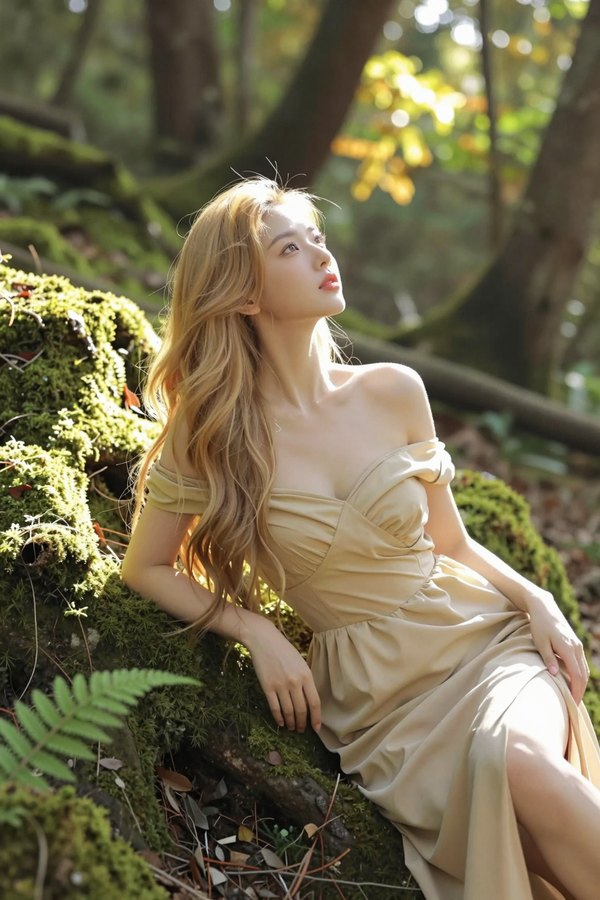

原编号 `Z64-36A`；尺寸 1024×1536；种子 293101。

原图 SHA-256 `88fc13cf857edcba1a0107dc1889c5ab23edeeff18a04f38b1023f8528065100`。

```text
竖幅2:3，一张在午后森林中拍下的唯美人像，取景从头顶到膝下。24岁的成年东亚美女斜倚在覆着翠绿苔藓的树根坡上，一只前臂轻轻支撑身体，另一只手放在裙面，肩背微微抬起。她仰头看向右上方树冠漏下的光，眼睛安静地追着亮处，嘴唇自然微分，像在林间停下休息时被拍到。漂亮的柔和心形脸，浅棕杏眼，蜜桃色唇，蜂蜜金色长发以宽松而不规则的波浪铺在左侧苔藓上。暖象牙色皮肤细腻，眼睑、唇线和脸颊的颜色变化自然可见。她穿浅金色低领露肩长裙，腰身贴合，柔软裙摆顺坡面铺开，侧面开衩露出一条自然舒展的长腿，衣褶轻盈。

午后阳光从画面右上方斜穿树冠，照亮人物身后的叶片、头发外侧、右肩与近处的苔藓，在不同距离的树根和蕨叶上留下一片片大小不同的暖亮面，画面左侧和树根背面保留深绿阴影。人物脸朝向右上方，斜侧暖光柔和照到额头、鼻梁和迎光脸颊，另一侧由林间开阔处的柔和天光回填，眼窝与下颌仍有温和的明暗起伏。

近处画角有稍虚的苔藓与蕨叶，中景人物和坡面清楚，后方可以分辨几层树干与透光叶片，最远处才融成疏密不同的金绿光斑。50毫米镜头，焦点在眼睛，景深容纳脸和肩。最亮的透光叶缘与少量发丝边缘轻轻散开，皮肤中间调、暗处发束和苔藓仍清楚有颜色。
```

### 02 溪畔白岩

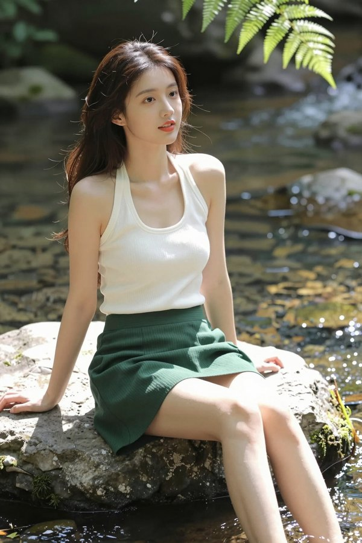

原编号 `Z64-45B`；尺寸 1024×1536；种子 301113。

原图 SHA-256 `e0137998205c5d5bf8032ba789980adcbd73265d4e0a9a96bb88354ea2bb19a6`。

```text
竖幅2:3，午后溪流边的唯美人像摄影，取景从头顶到膝下。25岁的成年东亚美女侧坐在溪边一块宽阔浅灰岩石上，双膝自然并拢向画面右侧斜放，小腿轻松垂向水面，左手支住身侧石面，右手松松搭在大腿上。她偏头看向水流，眼尾带一点被水声吸引的笑，嘴唇轻轻分开。她有漂亮的柔和方圆脸、舒展眉形、细长明亮的棕黑眼睛、圆润鼻尖和饱满的珊瑚色唇，深栗色长发半束，几缕被风轻轻吹起。象牙白低领挂脖针织小背心贴合胸腰，下配墨绿色A字短裙，裙摆停在大腿中部。裙子采用密实不透的斜纹面料与完整衬裙，面向镜头的前裙片连成完整布面，坐下后自然摊在并拢的双腿上，裙摆宽松地覆盖腿根，裙下只露出中段以下的大腿。裸肩与修长双腿舒展自然，针织柔哑，绿色裙料只形成宽缓自然褶皱。

阳光从画面右上方穿过树冠，照亮迎光的头发、肩膀、白色织物和溪边蕨叶，水面与浅岩反射宽柔的光照到脸颊，鼻梁与下颌有温和起伏。皮肤呈干净的暖象牙色，深发内部仍有棕黑层次。近处少量苔藓和绿叶虚化，中景人物与岩石清楚，远处溪水上的细小反光逐渐融进深绿树影，亮点只在水面。50毫米镜头，叶缘与水面最亮处轻轻柔化，面部、衣料和绿色暗部仍有细腻颜色，像停下来听溪水时拍到的一瞬。
```

### 03 花房暖光

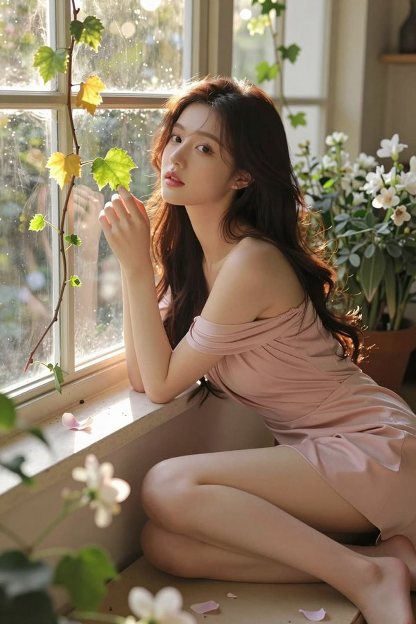

原编号 `Z64-40A`；尺寸 1024×1536；种子 296811。

原图 SHA-256 `b478ce69c70af12cbafee95927fb9ecd76d89532d1704f1795c3b88769f560dd`。

```text
竖幅2:3，一张被金色晚光包围的唯美花房写真，植物与人物处在同一片柔润的暖光里。25岁的成年东亚美女坐在老花房的浅色石台边，身体斜侧，一条腿轻轻向前伸，另一条腿屈起，手指随意搭着石台边缘。她刚把脸转向左前方透光的藤叶，睫毛微抬，嘴唇像轻轻吸了一口气。她有漂亮柔和的心形脸、深棕色杏眼、自然细眉、圆润鼻尖与饱满的花瓣粉唇，深栗色长发蓬松地从一侧肩上滑下。浅玫瑰粉色低领露肩短裙包住腰线，裙摆在大腿中段，肩头、锁骨和舒展的双腿清楚入画。相机从石台斜前方略高处拍到头顶和膝下，脸在画面偏上方，身体呈轻松的斜线。

夕阳穿过左前方的旧玻璃和攀援枝叶，透光的小叶片呈金黄与鲜绿，暖光落到她的脸颊、肩颈与双腿，裸露皮肤都有连贯的蜜桃奶油色，鼻梁与暗侧脸颊之间保持温和起伏。石台和浅墙提供柔软回填，栗色发束的外侧是棕金色连续光带，内部保留深色体积。少量白花、翠绿藤叶与透光的浅粉花瓣围在石台周围，近处的虚化花枝、清楚的人物和中景叶片、远处逐渐柔和的玻璃与枝叶形成层次。金色细小亮面落在叶缘与玻璃反光处，花瓣被照得轻盈通透，最亮的花缘与发丝有轻柔暖晕，眼睛和嘴唇仍清楚，整个花房安静而丰盈，像被偶然记录下来的暮光瞬间。
```

### 04 柠檬露台

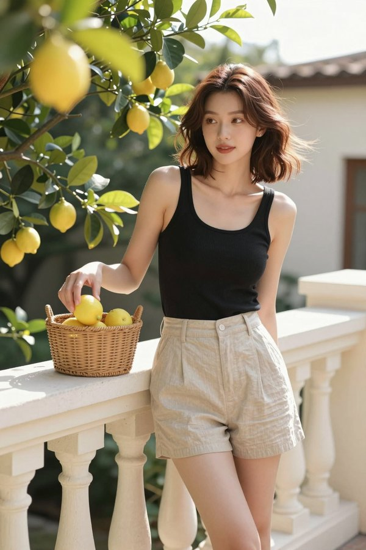

原编号 `Z64-41C`；尺寸 1024×1536；种子 297337。

原图 SHA-256 `4dc0c05abb18d5f401e955cb3ddd9b97971006262922a96ed42d3e5aad7d4baa`。

```text
竖幅2:3，柠檬树露台上的午后时装快照，从头顶取到膝下。26岁的成年东亚美女站在乳白石栏旁，刚把一颗柠檬放进身边的矮藤篮，右手仍松松停在篮边，左手轻扶石栏，重心落在后腿，前腿向一旁放松。她转头看向露台外，脸上有将笑未笑的神情，嘴唇轻合。漂亮的短鹅蛋脸，清晰而柔和的颧骨、略上挑的琥珀棕眼睛、舒展的眉和丰满杏玫瑰唇；栗色齐肩卷发有自然蓬松的发根，一侧发束被微风吹开。黑色低领细肩带小背心与浅沙色高腰亚麻短裤勾出腰线，裸肩、锁骨与修长大腿清楚，面料是细腻柔哑的真实织物。

斜阳从左上方照穿柠檬树叶，叶片的鲜绿与果皮的浅黄都通透，局部阳光落在肩头、发束和石栏上，脸由开阔天光与白石栏反射柔和照亮，鼻梁到暗侧脸颊保持细缓转折。肤色温润清爽，黑色背心保有深灰织纹。前景一簇虚化叶片贴着画角，中景人物与藤篮清楚，身后柠檬枝叶、奶油色墙和远处天空依次柔和，亮叶边缘只有轻微暖晕。50毫米镜头，明净、自然而有生气的午后光。
```

### 05 竹影青瓷

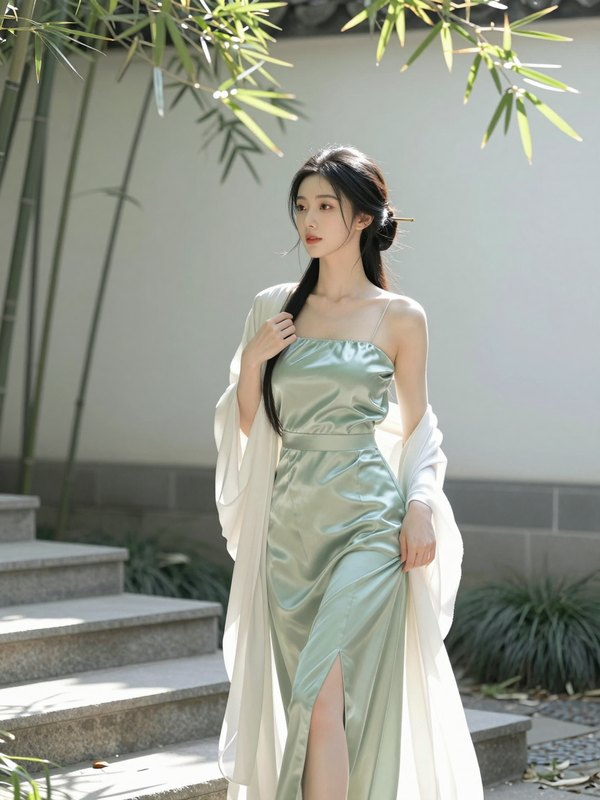

原编号 `Z64-32A`；尺寸 960×1280；种子 295005。

原图 SHA-256 `d5f4a68688d7ce366598154f6feb06f0c4f9ce00841ba0256f474a26141532d1`。

```text
竖幅3:4，现代东方时装的清透庭院写真，镜头从头顶取到膝下。24岁的成年东亚美女正从浅灰石阶上踏下一步，前腿落稳，后腿轻轻弯曲，一只手扶着肩边将要滑落的乳白披帛，另一只手自然垂下。她的身体斜侧，脸转向庭院里的竹叶，眼神安静而专注，嘴唇自然轻合。

她有漂亮的古典鹅蛋脸、清亮而略长的丹凤眼、舒展的细眉、小巧鼻尖与柔润玫瑰色唇。乌黑长发松松盘成低髻，一根细金簪只露出短短一端，颈边有两缕自然弧形碎发。暖白皮肤细腻，面部有轻微而自然的颜色起伏。

青瓷绿色丝质长裙采用低领挂脖剪裁，肩头与颈线清楚，腰部贴合，单侧开衩随迈步露出修长的大腿。胸腰臀有完整不透内衬，丝面呈宽缓而有颜色的浅绿折光；乳白披帛只有衣缘轻微透光，薄厚与裙料明确不同。

背景是米白庭院墙、少量纤细竹枝与灰色石阶，墙上的竹影形成大块疏密有致的形状。摄影师隔着画角一片虚化的竹叶，从石阶斜前方略低的位置拍摄，50毫米视角，人物仍占主要空间。

太阳被竹冠筛成宽窄不同的侧向亮面，落在裙摆和身后的白墙上，脸由宽柔天光与白墙反射照亮，五官保持温和起伏。深发是干净的黑色体积，皮肤高光小，丝面亮边轻微柔化，画面安静、通透而有真实庭院的空气感。
```

### 06 潮汐岩洞

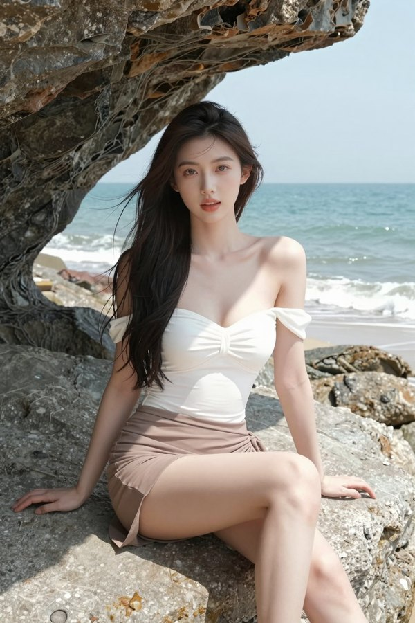

原编号 `Z64-44A`；尺寸 1024×1536；种子 300109。

原图 SHA-256 `ffc14fbf25f422afc9011a9154de687a9e02aa71cf2982ecb39bc10417dc728d`。

```text
竖幅2:3，海边浅岩洞口的通透人像摄影，取景从头顶到膝下。25岁的成年东亚美女侧坐在洞口宽阔的浅灰岩面上，一条腿自然斜伸，另一条腿屈起，右手支在平整岩面，左手松松搭在腿上。她转过脸平视镜头，神情放松，微分的唇像刚要说话。她有漂亮的柔和长鹅蛋脸、稍高但细腻的颧骨、清亮浅棕杏眼、修长眉形与饱满蜜桃色唇；深巧克力色长发松散披在肩后，几缕被海风吹向脸侧。海盐白色低领露肩连体泳装贴合胸腰，腰胯外系浅棕色不透短裹裙，裙摆在大腿上部，裸肩、锁骨与修长双腿完整可见。

人物坐在洞口的浅阴影里，洞外开阔天空和大片海面从左前方送来宽而柔的反射光，脸颊、裸肩和腿部明亮通透，鼻梁与下颌有细缓起伏，肤色保留温润蜜桃色。右侧浅岩反射微暖回填，深发内部有清楚棕黑体积，白色泳装的织纹仍可辨。近处洞壁占一角形成深灰层次，中景人物与岩面清楚，外面蓝绿海水、浅色浪线和远处天空逐渐柔和，洞口最亮边缘轻轻散开。50毫米镜头，清爽海光与柔润肤质，像在海边歇脚时拍到的一瞬。
```

### 07 沙丘白塑

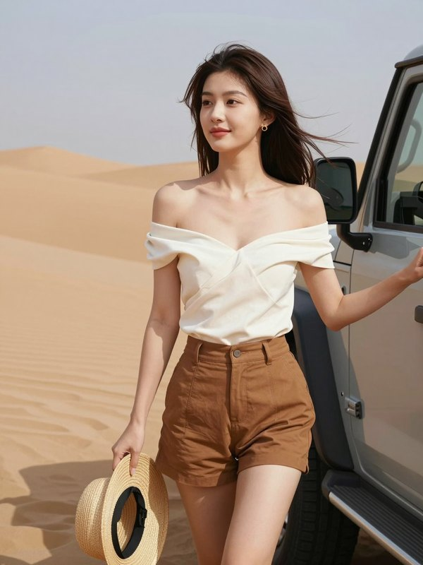

原编号 `Z64-28A`；尺寸 960×1280；种子 294553。

原图 SHA-256 `9fe6954eb4e8fb54cddc9a3b6fa771fd1949ba7f42c0fc0727d9d146e136e512`。

```text
竖幅3:4，沙漠大地色的高定旅行写真，头顶到膝下的中长景。26岁的成年东亚美女刚从一辆石灰色越野车旁走开一步，右手握着草帽的窄帽沿垂在身侧，左手轻搭车门外缘，前腿落稳，后腿保持迈步的轻微弯曲。她面向沙丘，侧脸略转向摄影师，唇角带一点从容的笑意。

她有漂亮的柔和方圆脸、自然清晰的颧骨、狭长而明亮的棕黑眼睛、略圆鼻尖和丰润的杏玫瑰色唇。深棕色长直发被风吹成几束流动的弧线，耳边有一枚很小的金色圆片。肤色是细腻的浅蜜色，脸部明暗过渡自然。

象牙白露肩上衣在胸前形成宽而立体的交叠弧线，低领结构与腰部收束清楚，面料是较挺的不透织物。焦糖色高腰短裤露出修长大腿，腰胯与裤腿有自然活动褶；裸肩、腰线和腿部在画面中舒展，草帽有真实编织厚度。

身后只保留一角越野车、几条柔和沙丘脊线和苍白蓝天，车身与沙面形成简单色块。摄影师从车头斜前方略低的位置拍摄，50毫米视角，手臂、帽子与车门都完整留在画框。

低斜太阳从她右侧照到脸颊、裸肩和白色衣料，浅色沙面提供宽柔回填，暗侧仍有清楚的温暖肤色。深棕发束反光连续柔和，白衣的亮面保留纹理，皮肤高光范围很小。成像清楚细腻，远处沙丘稍软，画面开阔、明净而有风。
```

### 08 蓝湖月纱

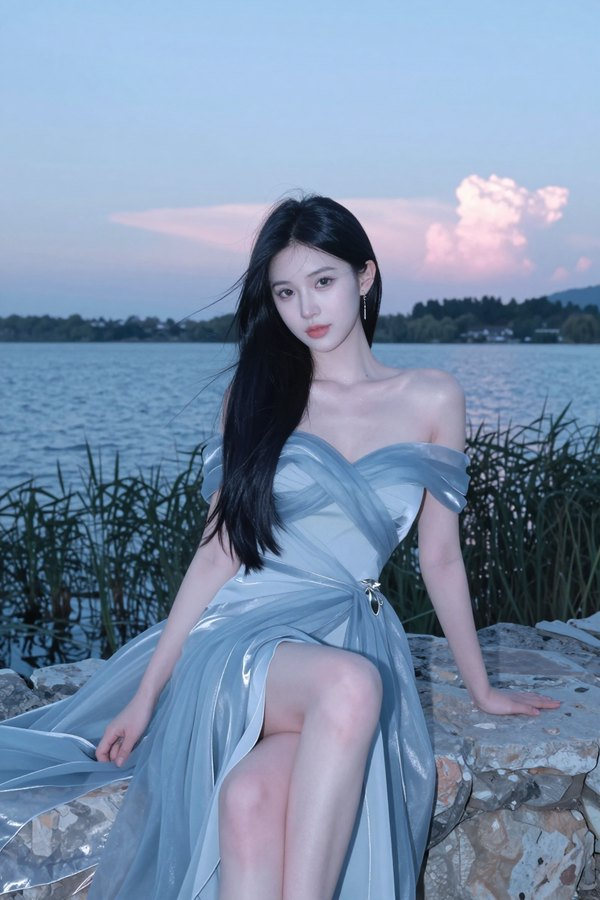

原编号 `Z64-02D`；尺寸 832×1248；种子 281032。

原图 SHA-256 `4f38a4887dfcd6e21c9353fc24706ecf658f645ceab339bbeee1164f05f311a9`。

```text
竖幅2:3，真实摄影质感的湖畔幻想时装写真。24岁的成年东亚美女坐在湖岸宽阔的浅灰石头上，一条腿自然垂落，另一条腿轻轻屈起，蓝色裙摆从膝边滑向石面。略低的斜侧机位拍到头部、腰线与完整双腿，侧坐的身体转向湖面，脸又微微转回镜头方向，视线停在镜头旁边。

她是修长精致的心形脸，眼距自然，细长而明亮的灰棕杏眼，鼻尖柔和，冷玫瑰色嘴唇轻抿，神态安静而有距离。柔顺的深蓝黑长发披在肩背，靠湖面的几束被风轻轻吹起，发根和内侧仍是有体积的深色。白皙皮肤有细微的粉色变化，脸颊和锁骨的反光很小，眼睛和唇线清楚。

她穿一条雾蓝色露肩心形领长裙，贴身上身与腰臀部分有不透的柔软衬里，外层是银蓝欧根纱，侧开衩露出一条腿，薄纱裙边顺着石头铺开。腰侧别着小巧银色叶片装饰，耳边是一枚细长月滴耳坠。一只手支在身后的平整石面，另一只手轻扶膝上的一层纱，手指顺着布料自然弯曲。

背景是日落之后尚未完全变暗的蓝灰湖面、远处低矮树影和一小片浅粉云。前景一簇芦苇柔和虚化，湖面反光仅在远处形成几条低亮度银蓝色带，人物周围留有安静空间。

宽阔的蓝调天空从侧前方照亮她的脸，身后残留的一点暖粉天光只染亮最外层裙边，石头与水面提供很弱的柔和回填。皮肤保留自然肤色，银蓝纱边轻微扩散，深发、眼睛与衣料层次仍可读。85毫米人像镜头，细腻低反差、清凉通透的湖边晚光。 蓝调环境光保留清凉气氛，脸部的回填宽而柔，暗侧仍有可读的自然肤色；柔化只落在湖面远景与银蓝纱边。
```

### 09 蔷薇酒红

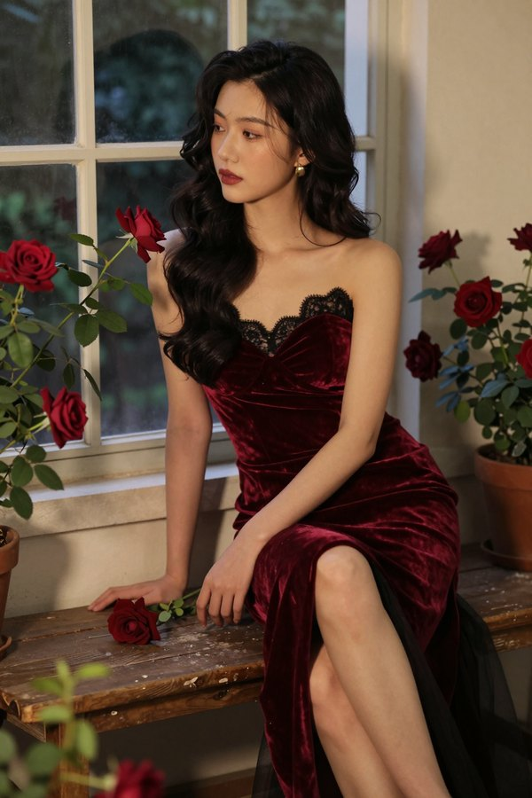

原编号 `Z64-04A`；尺寸 832×1248；种子 281094。

原图 SHA-256 `0a3a8f3c48bf896bfe93e2d1c7436fdd4a72ff9b9309e0d96d40e22c6048ab78`。

```text
竖幅2:3，复古花房高定时装摄影。26岁的成年东亚美女斜坐在一张低矮旧木长椅的边缘，身体略向前，双腿并拢自然斜向画面下方，镜头从平视略高的位置拍到头部和脚踝。她的手肘松松搭在膝上，手中只轻握一枝短茎暗红蔷薇，头转向左侧窗外，仿佛在听远处说话。

她有优美的长椭圆脸、略高但柔和的颧骨、深棕细杏眼和饱满的暗玫瑰色嘴唇，表情平静而专注。黑色长卷发偏分，波浪从一侧肩头垂下，另一侧露出纤细金色耳坠。肤色是干净自然的暖象牙色，嘴角和眼下保留轻微真实纹理。

酒红色丝绒礼服露出双肩，心形领上缘覆一层细黑蕾丝，腰线贴合，裙摆一侧的开衩露出修长小腿。丝绒亮面是深红色，转入阴影后变得浓暗柔哑；裙边搭着少量黑色薄纱，材质与丝绒清楚分开。衣料覆盖身体完整，动作重心由坐骨与脚掌共同支撑。

花房里只有几盆暗红蔷薇、旧玻璃窗和绿色藤叶，前景一枝叶片虚化，背景窗框逐渐模糊。木椅表面有细小磨痕，色彩集中在酒红、暗绿和温暖肤色。

傍晚低斜的窗光从左侧照到侧脸、锁骨与丝绒褶面，右侧浅墙反射少量柔光，让另一只眼和暗侧脸颊仍可读。亮部扩散很轻，丝绒保留细密绒毛反光，头发呈连续深棕黑色波纹。85毫米镜头，浓郁却有层次的复古色彩。
```

### 10 粉纱窗光

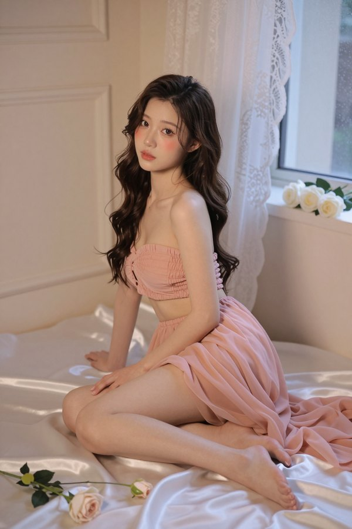

原编号 `Z64-09A`；尺寸 832×1248；种子 281249。

原图 SHA-256 `598a9b4288280a31ec4b62bbeded8e74000cda8d0152efc6ed1eee288b412189`。

```text
竖幅2:3，唯美而有真实摄影质感的室内全身写真。23岁的成年东亚美女侧坐在铺着象牙白与香槟粉缎面的地面，双腿并拢折向一侧，脚背放松，两只赤足完整入画。左手支在身后，右手轻搭大腿，身体向镜头微转，稍高机位顺着腿部斜线拍下这一瞬间。

她有漂亮的柔和鹅蛋脸，深棕色大杏眼，眼下自然饱满，微翘的鼻尖和柔润花瓣粉唇。她看向镜头，神态安静，像在等摄影师说下一句话。深棕长卷发中分，波浪从肩头落到腰下，眼睛、眉毛与唇纹清楚，白皙皮肤带细微蜜桃暖意。

上身是腮红粉细褶雪纺抹胸，贴合的内衬不透，腰臀裹着蜜桃粉欧根纱裙，重叠布料完整遮住腰臀，轻薄外层铺在并拢的腿侧和缎面上。裸肩、锁骨与腿部之间形成舒展的曲线，薄纱、雪纺和绸缎分别有不同厚度与折光。

奶油白石膏线墙面、右侧透光蕾丝窗帘和一座放着白玫瑰的矮台座构成背景，地面只散放少量花枝。近处一角缎面略虚，人物与裙褶仍在清楚的焦平面上。

右侧宽柔的傍晚窗光照亮脸颊、肩颈和缎面褶皱，浅墙反射的回填让暗侧仍有温和肤色。亮部边缘微微扩散，深色卷发保留体积，皮肤中间调细腻。85毫米镜头的浅景深，温柔但能摸到布料纹理的写真质感。
```

### 11 夕阳公寓

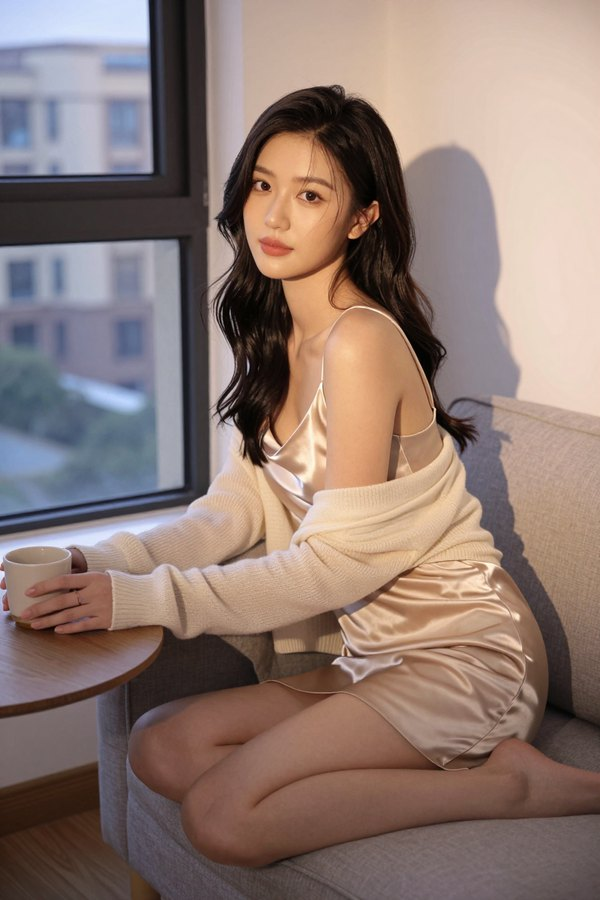

原编号 `Z64-15A`；尺寸 832×1248；种子 281435。

原图 SHA-256 `2294416a9d9972b3350df8b92cfbb73568d11b5c5d179dc7f4a05bce5fefdd04`。

```text
竖幅2:3，傍晚公寓里的真实时装写真。27岁的成年东亚美女刚把一只杯子放在矮桌上，仍然侧坐在沙发扶手边，身体朝前微倾，膝盖并拢斜向窗户，一只脚轻轻向后收。机位平视拍到头顶与双脚，腰背和腿部线条舒展而有支撑。

她有漂亮的方圆脸与柔和颧骨，细长清亮的琥珀棕眼睛、自然平直眉和丰满但克制的裸玫瑰色嘴唇。她偏头看向镜头旁的人，唇角像压着一点笑，表情带生活中的停顿。深棕长发偏分，松散大波浪垂在肩后，皮肤中间调细腻，眼下和鼻翼保留轻微肤色变化。

香槟色低领细肩带短裙贴合腰线，裙摆在大腿中部自然铺开，柔软缎面在胸前与腿边形成宽缓折光。肩头搭着一件轻薄奶油色针织衫，袖子落在手肘处。衣物覆盖完整，裸肩与长腿是构图中的自然部分，手掌和杯子的摆放清楚。

公寓里只有浅灰沙发、低木桌、白色墙面和一角透光窗帘，桌上是一只无装饰的陶瓷杯，身后窗外建筑虚化成暖灰色块。地板有轻微使用纹理。

夕阳从侧后方落地窗照过来，在一侧肩线和缎面形成暖金亮面，镜头方向的白墙反射补亮脸部，另一侧脸颊仍有柔和阴影。明亮窗边有局部光晕，面部和深发保持清楚。85毫米镜头，温暖而不刻意的生活质感。
```

### 12 旅店红电话


原编号 `Z64-26A`；尺寸 960×1280；种子 294327。

原图 SHA-256 `2739811a42ca28bbdff4b946127d73e6b53d0771e5b884a05a52f362a0b54838`。

```text
竖幅3:4，复古港风的夜间时装写真，人物从头顶到膝下完整入画。24岁的成年东亚美女站在旧旅店走廊的红色公用电话旁，身体半侧，刚把听筒放回底座，右手还停在听筒边，左手放松落在大腿侧。她偏头看向走廊深处，眼神专注，嘴唇像刚收住一句话，肩胯自然错开。

她有漂亮的心形脸、细长略上挑的深棕眼睛、柔软下颌和饱满的玫瑰红唇。深栗色齐肩卷发偏分，一侧露出小巧金色耳圈，眼尾只有很薄的暖棕妆色。皮肤是细腻自然的暖象牙色，鼻翼和眼下有轻微肤色变化，面部仍清爽明净。

墨绿色低领缎面细吊带贴合胸腰，露出肩颈，下配黑色高腰皮质短裙，裙摆停在大腿中段，腿部比例修长自然。缎面沿胸前与腰侧出现宽缓绿灰折光，皮裙表面只有常用部位的轻微磨光，衣料完整覆盖身体，金耳圈只提供小亮点。

背景由暗红电话、奶油色墙面和一串虚化的门洞构成，电话线清楚地落在底座旁，走廊尽头亮度很低。摄影师从走廊对面斜拍，50毫米镜头，手掌与电话都有完整的画框余量。

相机附近一盏柔和小闪光提亮脸、裸肩和衣料，侧后房门里的钨丝灯给走廊留一层暖色。脸颊反光受控，黑裙和深发仍有层次，背景暖灯只形成少量模糊亮块。成像细腻清楚，复古感来自色彩、服装与空间，皮肤保有真实的暖色中间调。
```

### 13 暮色海风

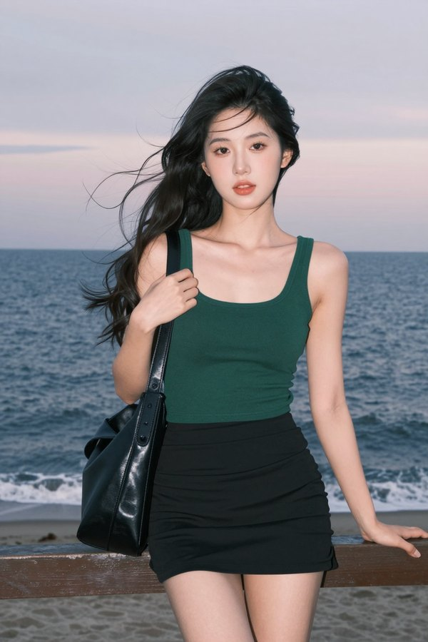

原编号 `Z64-13B`；尺寸 832×1248；种子 281373。

原图 SHA-256 `d5b55d1f428d635d6fce466a5b6479349f09bb382661ac7ce89d6b3d7241a7cd`。

```text
竖幅2:3，海边蓝调时刻的真实时装快照。24岁的成年东亚美女站在木栏杆前，刚被风吹动头发，身体微侧，一只手扶住肩上的黑色皮包带，另一只手自然搭在栏杆上。镜头在胸口稍低的位置拍到头顶和膝下，双腿修长自然，一条腿承重，另一只脚稍微向外放松。

她有漂亮的小圆鹅蛋脸、柔和卧蚕与明亮深棕杏眼，鼻尖圆润，微张的唇带自然珊瑚粉色。她正看向镜头，表情像要开口问一句话。深黑长卷发被海风带成几束有方向的弧线，眼周与嘴角仍清楚，皮肤保留细腻的暖粉层次。

贴身墨绿色低领小背心露出肩颈与锁骨，下配黑色高腰短裙，衣摆和裙褶在风中只有小幅度变化。背心是柔哑棉质，裙料较挺，皮包带有轻微磨光。穿搭清凉，领口和短裙长度清楚，人物姿态从容。 绿色背心的棉质表面柔哑细密，黑裙沿腰线和腿侧自然起褶，皮包带只有常用部位有柔和磨光。

身后是一条平静蓝灰色海面与浅粉天际线，旧木栏的横线压在腰部下方，远处浪花只是模糊浅色带。天空在画面上方留有呼吸空间。

大面积蓝调天光决定环境底色，相机旁很柔和的小补光只提亮脸与上身，脸部仍有轻微转折阴影，背景海天比人物暗一点。头发的外侧几束反射冷灰色连续光带，皮肤保持自然暖色。50毫米镜头，干净、轻微柔雾却清楚的黄昏人像。
```

### 14 银发女巫

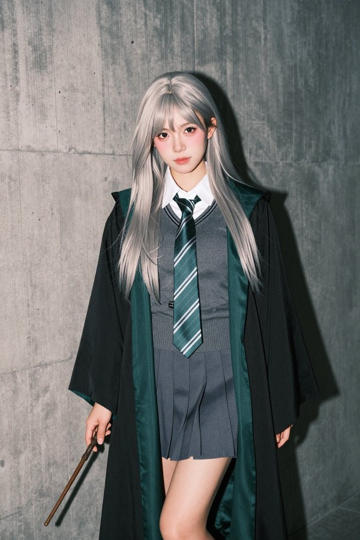

原编号 `Z64-05A`；尺寸 832×1248；种子 281125。

原图 SHA-256 `69d6badac5b6e1fc34502c2b43c1e7a095ba157eb8e42467aa5b8b6be068b16e`。

```text
竖幅2:3，35毫米胶片直闪角色写真。24岁的成年东亚美女扮作绿色学院风女巫，站在低饱和橄榄灰水泥墙前。机位略低，取景从头顶到膝下，短百褶裙、大腿和两只手都清楚入画。她将重心放在一条腿上，肩膀略斜，下巴轻抬，低眼看向镜头，浅粉嘴唇微微分开，神态有一点高傲却自然。

她有精致的小心形脸，黑棕色大杏眼、柔和鼻尖和小巧下颌，眼下是薄薄的红粉色妆晕，皮肤白皙但仍有脸颊淡淡的粉色。铂金银灰直长发垂过胸前，轻薄刘海露出部分眉毛，发束在暗处仍分得清。

贴身炭灰色细针织V领毛衣露出白衬衫衣领，胸腰曲线由真实针织张力体现，绿色银色条纹窄领带自然垂落。下穿炭灰短百褶裙，外披黑色宽袖巫师袍，翻开的内衬是有光泽的深祖母绿缎面。左前臂横搭腰腹，右手从袖口伸出，以拇指和食指轻握一根细长木魔杖，魔杖斜向画面下方，其余手指顺着握姿放松。

墙面紧靠人物，细微水泥肌理和袍衬折角能看清，背景只保留墙与低处地面的分界。人物外轮廓与身后的投影有明确间距。

相机附近的直闪照亮面部、白领和银发，在身后墙面投出清楚深色影子，额头与鼻尖反光面积小，肤色有柔和中间调。针织细纹偏哑光，缎面沿折痕反光，全画面分布均匀细胶片颗粒，像一张完成度很高的角色摄影底片。
```

### 15 黑旗袍红墙

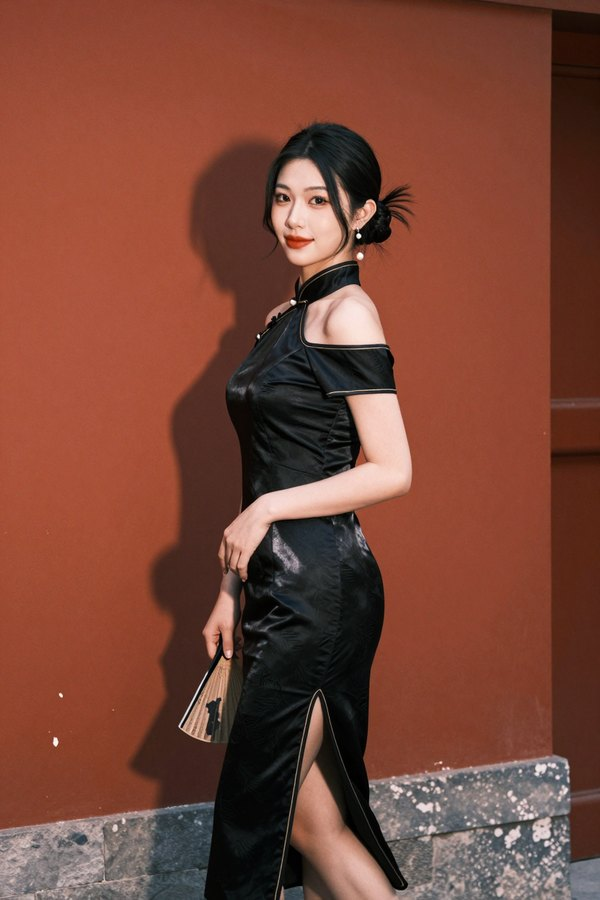

原编号 `Z64-08A`；尺寸 832×1248；种子 281218。

原图 SHA-256 `b20abd316b62179a636e8cab3d1e97954c9dd93100a2d2d4a9ee6b35d1fbfe21`。

```text
竖幅2:3，现代东方时装直闪写真。25岁的成年东亚美女站在暗朱红色旧墙前，身体三分之四侧向镜头，一条腿从侧开衩处向前迈出半步，肩膀轻轻回转。取景从头到脚，镜头稍低但透视克制，修长双腿和旗袍腰线都完整呈现。

她有明艳的鹅蛋脸、略上挑的细杏眼、清晰却柔软的下颌线，眼尾是很薄的暖棕眼妆，豆沙红色嘴唇自然闭合。乌黑长发盘成松松的低髻，脸侧垂下两缕有弧度的碎发，肤色是柔和的暖白色。她看向镜头，神态从容而带一点笑意。

黑色缎面改良旗袍是露肩剪裁，胸腰贴合，侧开衩露出承重腿，领口用细金色滚边收束。她一只手在腰旁握着收拢的折扇，另一只手顺着身体自然垂下，珍珠耳坠与小扇骨只提供少量亮点，服装的面料与缝线可读。

红墙有浅浅斑驳和灰色石脚，右侧远处露出一小段深木门框，人物身后留出可辨的影子空间。前景干净，背景没有额外道具。

近机位直闪从正面照亮脸、肩与黑缎曲面，墙上形成一条明确的人物投影，金色滚边与珍珠反光小而清楚。黑色缎面沿腰胯褶皱出现宽缓银灰折光，脸上是均匀但有起伏的自然肤色。35毫米胶片色彩，细颗粒完整覆盖画面，东方时装杂志的真实拍摄感。
```
